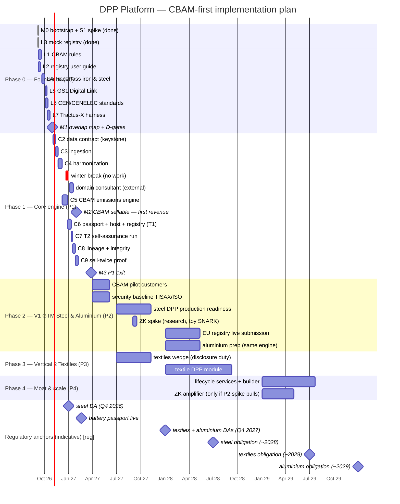

# Project Plan — Gantt (derived view)

Derived from `product-roadmap.md` **§5 Implementation timeline** (the single source of
truth). If dates change, update §5 first, then regenerate this file. Status anchor:
**6 Sept 2026**.

## Mermaid gantt

Renders on GitHub / Mermaid-capable viewers. Milestones: our gates (M0–M3) = `milestone`;
regulatory anchors (indicative) = `crit`-style diamonds flagged `[reg]`.

## Task list with dates & dependencies

| Task | Start | End | Depends on | Gate |
|------|-------|-----|-----------|------|
| M0 bootstrap + S1 spike | 2026-09-06 | done | — | S1 passed |
| L1 CBAM rules | 2026-09-07 | 2026-09-18 | — | feeds C5/D5 |
| L2 registry user guide | 2026-09-08 | 2026-09-15 | — | feeds D4/C6 |
| L4 TracePass iron & steel | 2026-09-21 | 2026-10-02 | — | feeds C2/D3 |
| L5 GS1 Digital Link | 2026-10-05 | 2026-10-09 | — | D7 |
| L6 CEN/CENELEC | 2026-10-05 | 2026-10-16 | — | D3 |
| L7 Tractus-X harness | 2026-10-12 | 2026-10-23 | — | T2/D6 |
| **M1** overlap map + D1–D7 | 2026-10-26 | 2026-10-30 | L1–L7 | M1 |
| C2 data contract (keystone) | 2026-11-02 | 2026-11-13 | M1 | D3 |
| C3 ingestion | 2026-11-16 | 2026-11-27 | C2 | T1 |
| C4 harmonization | 2026-11-30 | 2026-12-18 | C3 | T1 |
| (winter break) | 2026-12-21 | 2026-12-31 | — | — |
| **Domain consultant engagement (external, verifier-grade)** | 2027-01-04 | 2027-01-22 | C3+C4 scaffolding validated | details schema, data capture, calc models → C5 |
| C5 CBAM emissions engine | 2027-01-04 | 2027-01-29 | C4 | **M2** |
| C6 passport generator + DPP host + registry submit | 2027-02-01 | 2027-02-19 | C5 | T1 gate |
| C7 T2 self-assurance run | 2027-02-22 | 2027-02-26 | C6 | T2 |
| C8 lineage + integrity | 2027-03-01 | 2027-03-12 | C6 | — |
| C9 sell-twice proof | 2027-03-15 | 2027-03-26 | C5, C6 | **M3** (P1 exit) |
| CBAM pilot customers (P2) | 2027-04-01 | 2027-06-30 | M2 | revenue |
| Security baseline (TISAX/ISO) | 2027-04-01 | 2027-06-30 | P1 | — |
| Steel DPP production readiness | 2027-07-01 | 2027-12-31 | M3 | ~2028 |
| **ZK spike (research-only, toy SNARK)** | 2027-09-01 | 2027-09-17 | C5 engine | decision gate → P2.5 vs P4 |
| EU registry live submission | 2028-01-03 | 2028-06-30 | readiness | obligation |
| Aluminium prep (same engine) | 2028-01-03 | 2028-06-30 | M3 | ~2029 |
| Textiles wedge (disclosure duty) | 2027-07-01 | 2027-12-31 | M3 | — |
| Textile DPP module | 2028-01-03 | 2029-06-30 | P1 | ~2029 |
| Lifecycle services + builder (P4) | 2029-01-02 | 2029-12-31 | P2/P3 | T4 |
| ZK amplifier (P4, only if spike pulls) | 2029-01-02 | 2029-06-30 | P2 spike | optional |

## Regulatory anchors (indicative, not ours)

| Anchor | Date | Meaning |
|--------|------|---------|
| Steel DA adoption (Q4 2026) | ~2026-12-31 | first ESPR delegated act (indicative) |
| Battery passport live | 2027-02-18 | public validation of live registry |
| Textiles + aluminium DAs | ~2027-12-31 | adoption window (indicative) |
| Steel obligation | ~2028-06-30 | GTM readiness must precede this |
| Textiles obligation | ~2029-06-30 | P3 DPP module must precede |
| Aluminium obligation | ~2029-12-31 | rides steel engine |

## Notes

- Winter break (21–31 Dec 2026) shown explicitly; C5 moved to Jan.
- P2 CBAM pilot revenue may begin earlier (as soon as M2 lands, even mid-Jan).
- **Moat vs ZK:** the moat is the mass-balance/PCF + verification engine (M2/P2). The P2 ZK
  spike is research-only (toy SNARK over C5 output) and decides whether ZK is adopted in
  P2.5 or deferred to P4 as an optional amplifier — never a prerequisite.
- All DPP deadlines indicative → every build is schemas-as-data; the wedge revenue does not
  depend on any DA.
